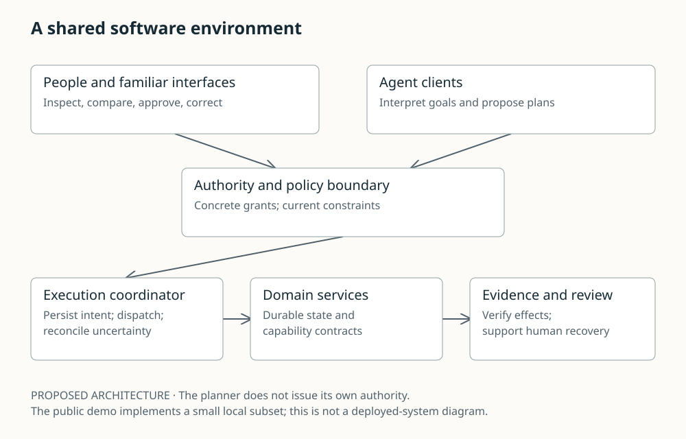

# Intent-Native Software

## The Internet of Delegated Action

**Humans, AI agents and the economics of the next software era**
Harry Henry Hanrui Wang · Founder, Walify · Working paper, 1 November 2026

The next software opportunity may lie in making delegated action dependable: persistent state, explicit authority, useful services and evidence that the intended effect occurred. This paper examines the architecture, human control and marketplace economics behind that thesis.

**[Read the complete paper](paper/PAPER.md)** · [Reading edition](paper/index.html) · [Research companion](research/README.md) · [Methods and limits](research/METHODS.md)



### What the paper develops

- Human-agent coexistence through shared state, bounded delegation and recoverable tasks.
- Tencent/Weixin, Alibaba and US ecosystem strategies, separating documented announcements from hypothesized advantages.
- Model progress, open weights, inference economics and the costs that remain after code generation becomes cheaper.
- Capability marketplaces, cold starts, network effects, portability and the conditions for concentration.
- Walify's author-stated vision: software that people and agents use together, with Tavi as the personal assistant.

The paper contains 25 chapters, 30 source notes, 20 proposed evaluation protocols, 10 dated working forecasts and five figures. It is an AI-assisted position paper, not peer-reviewed research or an endorsed frontier-lab publication. Monopoly is analyzed as a conditional outcome, not promised.

### Inspect the working code

The [execution demo](demo/README.md) models exact-request approval, expiry, revocation, cancellation, a simulated provider, restart recovery and receipt verification. Five [analytical models](research/README.md#executable-analytical-models) explore workflow reliability, participation feedback, model routing, verification cost and duplicate effects.

```sh
python3 -m unittest discover -s demo -v
python3 -m unittest discover -s research/experiments -v
python3 -m unittest discover -s scripts -p 'test_*.py' -v
python3 scripts/validate_research.py
python3 scripts/run_models.py
python3 demo/scenarios.py
```

The demo and models use Python's standard library, make no external-service calls and need no credentials. Model results are hypothetical sensitivity analyses. They do not measure any company's agent performance, revenue or adoption.

### Reading and reuse

Download the [standalone HTML edition](paper/index.html) and open it locally for a responsive, print-friendly version with inline figures. It is a committed artifact, not a deployed website. See [rebuild instructions](paper/README.md) for the manuscript and plots.

The [original execution-semantics essay](docs/execution-semantics.md), [earlier research agenda](docs/research-agenda.md) and [ecosystem chapter](docs/ecosystem-native-agents.md) remain available as background. The new paper and source register provide the current research synthesis.

Read [the release record](research/RELEASE.md) for validation scope. No private Walify code, infrastructure or metrics are part of this repository's research edition.
