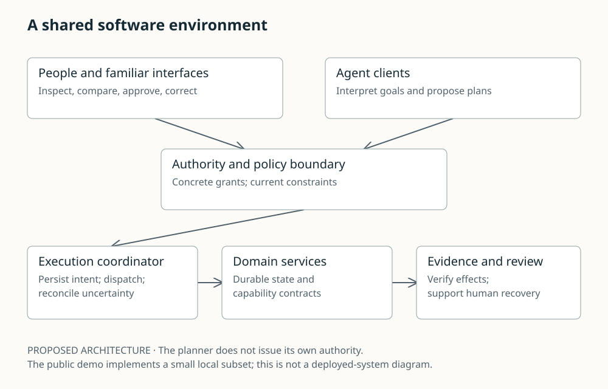
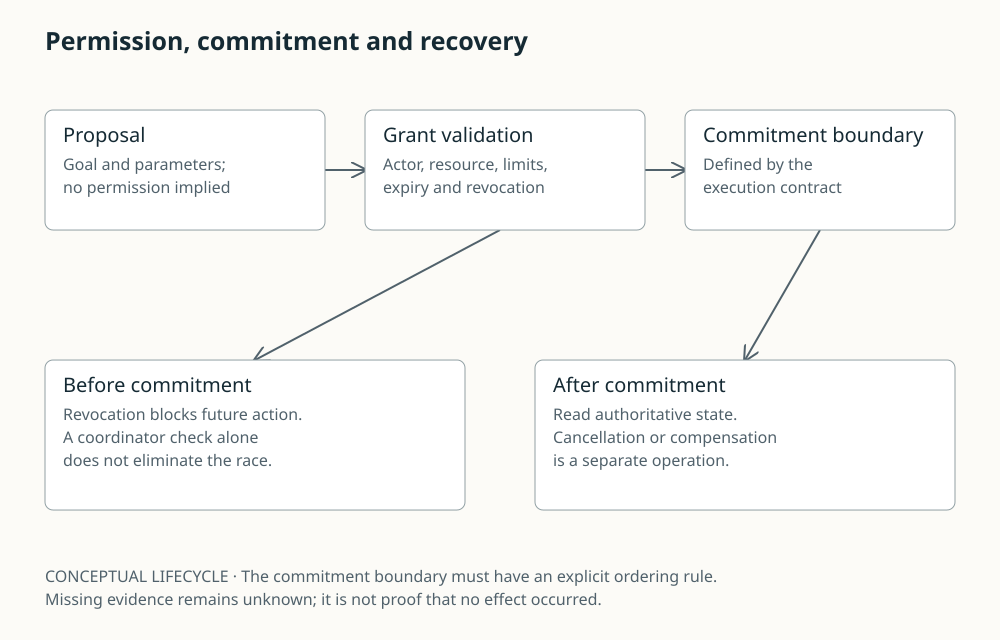
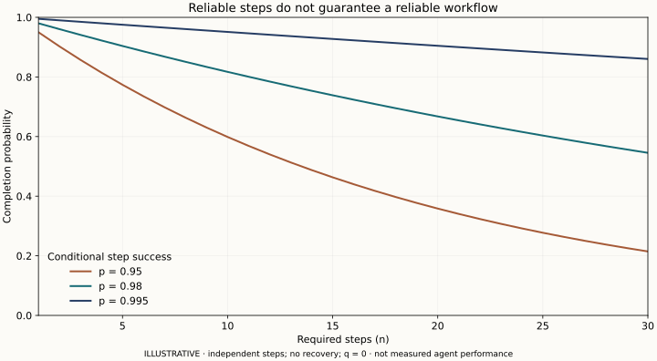
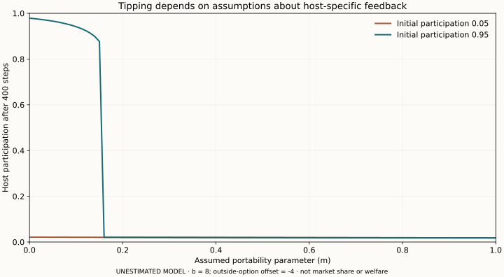
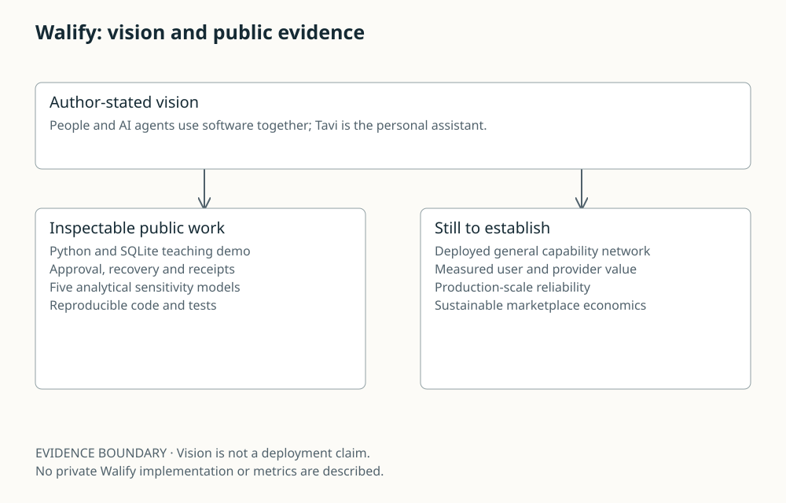

# The Internet of Delegated Action

## Humans, AI agents and the economics of intent-native software

**Harry Henry Hanrui Wang · Founder, Walify**

**Working paper · 1 November 2026 · AI-assisted research and writing**

### Abstract

As AI systems become better at planning and using tools, software can increasingly accept goals rather than only sequences of interface operations. This paper argues that dependable delegation requires a shared substrate of persistent state, explicit authority, semantic contracts and evidence of effects. It examines human-agent coexistence, integrated ecosystems in China and the United States, open model economics and the conditions under which an intent marketplace could acquire durable power. The argument is conditional: integration may reduce coordination failures, while portability, multihoming and specialization may prevent market tipping. Walify is presented through its author-stated vision of software for people and agents; the independently inspectable implementation is a local execution demo. Five analytical sensitivity models, twenty proposed protocols and ten dated forecasts expose the assumptions and missing evidence. No live comparative benchmark, adoption result or monopoly forecast is claimed as established fact.

**Reading guide:** Chapters 1–7 define the architecture; 8–11 compare ecosystem mechanisms; 12–20 examine models, economics and governance; 21–25 connect the vision to testable next steps.

**Evidence:** [Methods](../research/METHODS.md) · [Research companion](../research/README.md) · [Public demo](../demo/README.md)

# 1. The new scarcity is dependable action

The internet taught software to publish information, expose APIs and distribute applications. AI adds a different possibility: people can describe an outcome and ask software to coordinate the steps. The resulting market is not simply a larger market for chat. It is a market for converting uncertain descriptions into authorized changes in the world.

Our central thesis is that, as competent planning becomes more available, a larger share of software value can accrue to the infrastructure that makes actions discoverable, permissible and verifiable. The important qualification is *can*. Models may remain a binding constraint in difficult domains; distribution may remain expensive; many people may prefer direct controls. The opportunity exists only where a new coordination system improves the entire task.

Consider arranging a group trip. Generating an itinerary is an information task. Reserving compatible transport, securing agreement, handling a cancellation and explaining who paid is a coordination task. The latter crosses authority and organizational boundaries. A better language model helps, but it cannot manufacture missing permission or compel an unavailable supplier to honor a booking.

This paper calls the proposed architecture **intent-native software**: persistent domain services expose explicit capabilities, and both humans and agents operate through inspectable contracts. Interfaces become views over durable state. The architecture is a proposal, not a claim of invention of APIs, workflow engines or delegated authorization.

The contribution is a synthesis with an evaluation program: language-originated plans are treated as revisable proposals over durable service contracts; coexistence is defined through inspectable state and recoverability; and platform power is analyzed separately from technical usefulness. Existing workflow engines already orchestrate services. The proposed difference is admitting uncertain, user-specific plans while retaining externally enforced authority and evidence. Whether that difference justifies new infrastructure is the question to test.

The argument has three levels. First, there is an engineering question about reliable delegated effects. Second, there is a human question about understanding and control. Third, there is an economic question about which actor captures value when the first two become easier. Confusing the levels produces seductive but weak forecasts: a benchmark improvement becomes an assumption of universal autonomy, which becomes an assumption of monopoly.

The ambition of *Situational Awareness* is a useful reference for exposing a causal thesis to scrutiny. Our subject and method differ: the focus is software institutions under multiple capability trajectories, rather than an assertion of a particular AGI date. [S01: Situational Awareness: The Decade Ahead](https://situational-awareness.ai/)

*Figure: Proposed shared software environment.*

# 2. Coexistence means shared state and bounded agency

Humans and agents will often inhabit the same workflow rather than alternate between separate worlds. A person may start a plan, an agent may collect offers, another person may change a constraint, and a service may report a delayed result. The design problem is maintaining a common understanding across those transitions.

Define coexistence operationally through four properties. **Legibility:** a person can inspect the current commitment. **Intervention:** they can pause or change future action. **Continuity:** another interface can resume the task without losing its meaning. **Accountability:** records identify the principal, delegated authority, provider and observed outcome. None requires an agent to imitate a person.

An assistant should make its role visible to counterparties where that matters. A service should distinguish a user's instruction from an agent's inference about that instruction. An affected person who never used the assistant should still have a route to dispute an incorrect invitation or transaction. A system that optimizes the principal's convenience while imposing unexplained costs on everyone else has not solved coexistence.

The broader assistant-ethics literature treats privacy, manipulation, cooperation and relationships as connected design questions. This paper narrows that agenda to observable software properties rather than assuming a conversational interface creates trust. [S26: The Ethics of Advanced AI Assistants](https://arxiv.org/abs/2404.16244v2)

The practical unit is a *jointly recoverable task*. If an agent cannot complete a request, a person should receive enough state to continue: attempted actions, confirmed effects, unresolved uncertainty and remaining permissions. A transcript alone is insufficient because it mixes intentions, speculation and facts.

This leads to a different optimization target from maximum autonomy. Minimize the total burden of obtaining a satisfactory outcome, including supervision, mistakes and recovery. Sometimes the best assistant takes the next step; sometimes it supplies a clear form; sometimes it asks a precise question. The division of work should depend on evidence about the task, not an aesthetic preference for removing every button.

# 3. From language to an executable contract

An instruction is usually incomplete. “Find somewhere for Friday” leaves unresolved the participants, time, budget and whether the user wants a suggestion or a commitment. Treating fluent interpretation as authorization makes uncertainty invisible at the most consequential moment.

Represent an interpreted intent as I = (G, C, A, E): a goal predicate G, constraints C, delegated authority A and required evidence E. This is a modeling choice for the study, not a new standard. The components separate questions that a chat message compresses into one sentence.

For an illustrative booking, G means a confirmed reservation exists; C includes the date and party size; A allows searching but may require explicit approval for commitment; E is an authoritative provider record matching the approved request. “The tool returned success” satisfies none of these conditions by itself.

A capability contract K = (X, Y, P, Q, F, V) records input and output types, preconditions, postconditions, declared effects and version. Structural validation checks X and Y. Domain validation checks meanings such as currency, timezone and recipient identity. Authorization checks whether the current principal may produce F under this request. Verification checks whether evidence supports Q.

The contract should also expose uncertainty: unavailable, rejected, pending and indeterminate outcomes require different recovery. Converting them all to an exception string gives the planner too little information to act responsibly.

A worked example makes the boundary concrete. A person asks an assistant to reserve a meeting room and invite four colleagues. The assistant proposes a room at a stated price, obtains an exact approval and dispatches the reservation. The response is lost. It does not book a second room: the task becomes indeterminate until an authoritative lookup confirms the first reservation. Only then does it draft invitations. If the room is unavailable, a more expensive alternative requires new approval. If an invitation fails after the booking succeeds, the system reports partial completion; cancellation is a new decision with its own fee and authority. The provider benefits from fewer duplicate requests, while the user benefits only if checking and recovery cost less than the original manual process.

The difficult research question is how much contract work pays for itself. A perfectly described capability that nobody maintains is worse than a stable conventional integration. We therefore propose measuring authoring and maintenance time per verified task, including semantic changes and broken versions. The thesis loses force if contract overhead exceeds the saved coordination cost.

The public demo provides one small implementation of exact-request approval and evidence checking. It has no language-model interpretation stage; that boundary is deliberate, and it prevents its deterministic results from being mistaken for agent intelligence. [S28: Intent-Native Software: public execution demo](https://github.com/henrywang-12/intent-native-software/tree/4a984b552067bcc141d18052d304a08f6111ab52/demo)

# 4. Authority must survive model substitution

A capable model is not an identity system. A persuasive explanation is not a delegation grant. If replacing the planner changes what the application is permitted to do, authorization is embedded in the wrong place.

Let a grant bind a principal, actor, capability, resource set, parameter limits, expiry and revocation state. At dispatch, the runtime evaluates the concrete action against that grant and the current service state. The model can propose a different action, but the proposal does not expand the grant. Child delegation should only attenuate authority: its permitted actions are a subset of the parent's.

Structured authorization already has a standards foundation. RFC 9396 provides a way to carry fine-grained authorization details in OAuth, including API-specific semantics. It does not remove the need to define and enforce the meaning of those details. [S07: RFC 9396: OAuth 2.0 Rich Authorization Requests](https://www.rfc-editor.org/rfc/rfc9396.html)

There are two separate races. The user may revoke permission between planning and dispatch. The provider state may change between inspection and commitment. Handling the first requires a declared commitment boundary: the service must define when a grant is consumed and how revocation is ordered against dispatch. A coordinator-side check alone leaves a race before provider commitment. Revocation after the declared boundary may require provider cancellation or compensation. Handling state drift may require a version condition, reservation or renewed quote. A single initial approval cannot make both races disappear.

Human approval is useful when it reveals the actual decision. Show the recipient, amount, lasting effect and uncertainty. Avoid asking a person to approve a vague plan and later interpreting that as approval of materially different parameters. Repeated low-information confirmations train users to stop reading.

Our proposal allows previously authorized low-risk actions to proceed without another prompt when the grant remains applicable. The criterion is bounded authority, not constant interruption. Consequential deviations require a new decision.

This boundary makes open and proprietary planners easier to compare. Both receive the same capabilities and are judged under the same rules. The system's authority should remain intelligible even if the model is wrong, unavailable or replaced by a conventional algorithm.

*Figure: Permission and commitment boundaries.*

# 5. A timeout is a state of knowledge

Suppose an agent submits a booking and the connection closes. The absence of a response says something about the coordinator's knowledge, not necessarily about the provider's state. The provider may have committed the action. Blindly submitting again can create a duplicate.

Use an explicit lifecycle: proposed, authorized, executing, verified, rejected, cancelled or indeterminate. These names are less important than the invariants. A verified result requires matching evidence; cancellation before dispatch differs from compensation after an effect; uncertainty must remain visible until resolved.

HTTP idempotence provides relevant vocabulary, but it does not guarantee exactly-once business execution. Repeated requests are safe only under the operation's actual semantics and the provider's deduplication contract. [S08: RFC 9110 section 9.2.2: Idempotent methods](https://www.rfc-editor.org/rfc/rfc9110.html#section-9.2.2)

An execution coordinator should persist intent before dispatch and retain the provider's reference afterward. Recovery first asks what happened. If the evidence is missing, stale or contradictory, another attempt may require waiting, human intervention or a fresh authorization. The correct action can be to stop with an honest unknown.

Multi-service work adds partial completion. If transport is reserved and a hotel fails, “undo” may involve cancellation fees and lost availability. Saga-style compensation is a precedent for organizing such recovery, but a compensating transaction is not time travel. [S09: Sagas](https://sigmodrecord.org/1987/12/09/sagas/)

The public demonstration uses a simulated provider with permanent deduplication and direct state inspection. Real providers can have shorter deduplication windows, delayed reads and different refund rules. The paper's evaluation protocols deliberately remove those conveniences.

This has a market consequence. A platform with reliable status APIs and clear recovery procedures can create value even without the best planner. Conversely, a platform with excellent reasoning and poor evidence can make users pay for its uncertainty. Reliability is partly an institutional property of the environment, not merely a characteristic of the model.

*Figure: Illustrative independent-step reliability; not measured performance.*

# 6. The interface becomes a projection

If both humans and agents act on the same domain service, the interface need not be the service's sole identity. A task can appear as a conversation, a calendar, a table or a review screen while preserving the same underlying commitment.

This is not an argument for generating every screen. Stable layouts support spatial memory, comparison, expert speed and accessibility. A user selecting among many options may prefer a table to a long conversation. A generated interface is valuable when it reduces irrelevant navigation without making important state disappear.

The architectural rule is shared semantics. Changing the date through a form and changing it through conversation should invoke compatible validation and authorization. The agent must not have a hidden shortcut around the rules that constrain the visible product.

Human-AI interaction research emphasizes setting expectations and supporting correction when systems fail. These are useful design principles, but the quality of a particular interface still requires testing. [S23: Guidelines for Human-AI Interaction](https://www.microsoft.com/en-us/research/articles/guidelines-for-human-ai-interaction-eighteen-best-practices-for-human-centered-ai-design/)

Measure *comprehension after action*: can a person identify what changed, who received information, which future steps remain permitted and how to stop them? A system that reduces clicks while increasing misunderstandings has shifted work into a less visible place.

Persistent task objects also let interfaces specialize. A compact mobile view can show pending decisions; a desktop view can expose comparisons; an accessible text view can present the same commitments in sequence. The service keeps the authoritative state, while each projection offers a different way to reason about it.

The forecast is a weakening of the exclusive connection between an application and one primary interface. It does not require the disappearance of apps. The strongest version of intent-native software may combine conventional interfaces with agent coordination, letting people move between them without restarting their work.

# 7. Interoperability has four layers

Two agents can exchange valid messages and still fail to cooperate. One may interpret a deadline as local time, another as UTC. One may accept a request as tentative, another as binding. A shared wire format does not settle those differences.

Distinguish four layers: transport, meaning, authority and commerce. Transport moves messages. Meaning establishes compatible units, entities and postconditions. Authority determines who may do what. Commerce establishes who pays, who carries risk and how disagreements are resolved. An ecosystem can be open at one layer and restrictive at another.

MCP provides a concrete host-client-server architecture for connecting tools and context. A2A's launch addresses coordination between independently built agents. They are relevant building blocks, not evidence that every service can already be composed safely. [S06: MCP architecture, 2025-06-18 specification](https://modelcontextprotocol.io/specification/2025-06-18/architecture) [S05: Announcing the Agent2Agent Protocol](https://developers.googleblog.com/en/a2a-a-new-era-of-agent-interoperability/)

A capability directory therefore needs more than a natural-language description. Useful metadata includes versioned schemas, effect classes, authentication requirements, evidence endpoints, failure modes and geographic or business constraints. Discovery quality should be measured by whether the selected capability satisfies the task, not whether its description sounds relevant.

Semantic portability can be tested with a substitution experiment. Replace provider A with provider B while keeping the user's goal constant. Record which fields, policies, assumptions and recovery paths must change. A low adapter count is impressive only if the new workflow preserves its meaning.

There is an economic tradeoff. Rich standards reduce repeated negotiation but impose implementation costs and may freeze imperfect abstractions. Thin standards spread more easily but leave significant integration work to hosts. A promising platform exposes a minimal common contract and keeps domain-specific obligations explicit.

The important prediction is not that one protocol will own the internet. It is that the cost of joining a useful execution network becomes measurable and strategically important. If that cost falls sufficiently, independent services gain an alternative to rebuilding themselves inside every host.

# 8. What the Weixin precedent actually teaches

The relevant lesson from Weixin is the possibility of gathering discovery and service interaction inside a frequently used environment. Tencent describes Mini Programs as services available through search or QR access within Weixin. That is a distribution precedent, not proof that every Mini Program is an agent tool. [S02: Weixin Mini Programs](https://www.tencent.com/products/weixin-mini-programs/)

The causal hypothesis is straightforward. A shared environment can reduce the number of times a user must establish context, navigate an unfamiliar interface or reconnect an account. If agents can use reliable service contracts in that environment, fewer uncertain handoffs may improve end-to-end completion.

But the inference has limits. A human-oriented embedded application can still require fragile interface automation. Different providers can maintain different semantics and permissions. A large service catalog can contain low-quality or stale entries. Colocation is an opportunity to standardize execution, not evidence that standardization has occurred.

For a new platform, copying the visual appearance of a superapp is the least interesting part. The hard work is assembling useful supply, recurring demand and institutions that make transactions dependable. A page full of tools without trustworthy providers is a catalog, not an economy.

There are also disadvantages to integration. Shared infrastructure can create common failure modes. A single routing policy can disadvantage a provider. Users may value the convenience but dislike losing control over their identity or history. These costs must appear in the comparison rather than being treated as externalities.

The proposed experiment holds the model and task set constant while changing the integration environment. It measures completion, supervision time, incorrect effects and recovery. Only then can we attribute an advantage to ecosystem structure rather than model quality, favorable task selection or a staged demonstration.

The geographic comparison in this paper is therefore specific: named products illustrate different architectural choices. It does not turn those examples into claims about every Chinese or American company.

# 9. Alibaba and the conversion of services into actions

Alibaba's January 2026 Qwen announcement explicitly connects a conversational product to existing commerce, travel, mapping and payment services. Its rollout distinguishes public testing, explicit payment confirmation and an invite-only assistant feature. These details matter more than a broad claim that agents can do everything. [S03: Qwen App advances agentic AI strategy through ecosystem services](https://www.alibabagroup.com/en-US/document-1948497434959151104)

The strategic mechanism is the conversion of existing service relationships into executable capabilities. A company already participating in transactions may possess provider integration, inventory access, identity relationships and customer support processes that a model-only entrant must negotiate separately.

That does not make the model irrelevant. Ambiguous requests, changing circumstances and long workflows can still defeat an integrated product. Nor does it establish a measured performance lead. The announcement is evidence of direction and scope, not an independent experiment.

The more general insight is that an agent product can inherit the strengths and weaknesses of the institution beneath it. Good service infrastructure can reduce failure. Restricted supply can bias the available choices. Existing payment relationships can lower friction while also raising switching costs.

For an independent provider, joining such an ecosystem creates a bargain: access to demand in exchange for integration cost and dependence on the host's ranking and rules. The bargain can be attractive without being permanent. A provider may participate in several ecosystems if maintaining those connections is affordable.

For a new entrant, the challenge is to create comparable coordination value before it has comparable breadth. That suggests a narrow domain with clear evidence of completion and manageable recovery, then expansion based on measured reuse of the same contracts.

The lesson is not to promise a universal assistant on day one. It is to make a small set of useful outcomes reliable enough that people return and providers can justify integration. The agent interface amplifies a functioning service system; it cannot substitute for one.

# 10. The United States also has ecosystem strategies

A contrast between “Chinese ecosystems” and “American standalone models” is too coarse. OpenAI's Apps launch combines conversation, app discovery and interactive interfaces. Google's A2A announcement emphasizes coordination across independently built agents. These are different routes toward connecting intelligence with software services. [S04: Introducing apps in ChatGPT and the new Apps SDK](https://openai.com/index/introducing-apps-in-chatgpt/) [S05: Announcing the Agent2Agent Protocol](https://developers.googleblog.com/en/a2a-a-new-era-of-agent-interoperability/)

The architectural comparison should distinguish ownership integration from protocol integration. In the former, a group controls several important service components. In the latter, independent providers cooperate through shared interfaces and commercial agreements. Most large products can combine both.

Ownership may simplify priorities and support escalation. It can also limit the choice set and concentrate failure. Protocol integration may broaden supply and preserve independent ownership. It can also leave semantic disagreements and support responsibility unresolved.

A fair analysis asks which boundary is expensive in a given task. If the hard problem is accessing inventory and settling a dispute, more capable reasoning may not help much. If the hard problem is interpreting an unusual technical document, better reasoning may dominate. No national label answers that question.

We propose reporting an integration profile for each evaluated environment: identity reuse, discovery coverage, capability semantics, approval granularity, execution evidence and recovery support. This profile is more informative than an unsupported overall “agent readiness” score.

The future may contain several powerful gateways serving different contexts: consumer coordination, professional work, regulated services and developer tools. Shared standards can connect them while their user experiences and business incentives remain distinct.

This weakens the strongest monopoly claim but strengthens the research problem. The interesting question is which functions exhibit scale advantages that survive interoperability. Distribution and trusted service relationships may remain concentrated even when the model and protocol layers are competitive.

# 11. A comparison that can be tested

This paper proposes comparing environments along observable dimensions rather than ranking countries. The table below compares hypotheses, alternatives and required measurements. Documented product features remain in the source notes and preceding chapters; these rows are proposed mechanisms, not reported product scores.

| Dimension | Integrated environment hypothesis | Open-web alternative | Required measurement |
|---|---|---|---|
| Discovery | Shared catalog reduces search effort | Federated directories broaden choice | Correct provider selected |
| Identity | Fewer repeated connections | Portable credentials reduce host dependence | Setup and recovery time |
| Meaning | Common contracts reduce mismatch | Domain standards permit substitution | Semantic error rate |
| Authority | One review surface may improve clarity | Independent grants limit host power | Unauthorized effect rate |
| Evidence | Shared status paths simplify recovery | Provider-signed or authoritative records | False success declarations |
| Governance | One operator can resolve disputes | External appeal avoids unilateral control | Resolution time and fairness |

Every row contains a tradeoff. Shared identity can simplify use and increase the consequences of compromise. A common catalog can improve relevance and create incentives to privilege the host's own services. Portable credentials can lower switching costs but create coordination and revocation challenges.

The cleanest experiment uses the same planner and task distribution in both environments. A second experiment varies the planner while holding the environment fixed. Their interaction reveals whether improved models substitute for integration or make integration more valuable.

Measure all assigned tasks, including refusals and unresolved cases. Excluding difficult workflows because one platform cannot support them converts coverage differences into misleading success rates. Report both coverage and conditional success.

This paper provides those experiment designs and sensitivity models. It does not contain a live comparative benchmark of Tencent, Alibaba, OpenAI, Google or Walify. The strongest current conclusion is architectural plausibility with explicit ways to test it.

# 12. Model progress is a portfolio of improvements

Forecasting the future of models through a single parameter count or leaderboard position hides several mechanisms: training allocation, post-training, inference-time computation, tool integration and specialization. Their economic consequences differ.

Compute-optimal training research studies the allocation of a training budget. Test-time compute research studies how additional reasoning or search changes answers under an inference budget. Neither implies that unlimited computation produces unlimited reliable agency. [S18: Training Compute-Optimal Large Language Models](https://arxiv.org/abs/2203.15556) [S19: Scaling LLM Test-Time Compute Optimally can be More Effective than Scaling Model Parameters](https://arxiv.org/html/2408.03314v1)

The practical frontier is a surface over quality, cost, latency, resource use and controllability. A model can improve on one axis while becoming less suitable for a particular workflow. Long deliberation can help a difficult analysis and frustrate a time-sensitive interaction.

Our forecast is that software will increasingly route work across models and conventional components. A cheaper model can classify a request, a stronger model can propose a difficult plan, a deterministic gate can enforce limits, and a provider record can establish an outcome. The quality of this composition matters more than the prestige of one model name.

There are three capability scenarios. In the fast case, models become much more reliable on long tasks and the bottleneck shifts toward authority and service access. In the uneven case, selected workflows automate while others retain substantial supervision. In the slow case, assisted interfaces and conventional automation remain the main value. The proposed architecture has a role in each, but its investment justification changes.

The paper makes no precise AGI-date prediction. Instead, its forecast ledger contains operational events: independently reproduced workflow results, model substitution without rewriting policy, and evidence of maintained cost-quality gains. These can be resolved without agreeing on a definition of general intelligence.

The model race and the platform race are related but distinct. A temporary model lead can create distribution. A useful service network can remain valuable after that lead narrows. Whether either advantage persists is an empirical question.

# 13. Open models change bargaining power, not every bottleneck

Open weights can give a software operator more choices about deployment, customization and provider dependence. They do not automatically provide inexpensive serving, training reproducibility, usable data rights or access to external services.

The Open Source Initiative's definition treats code, parameters, data information and freedoms together. We therefore distinguish open weights from a verified claim of open-source AI under that definition. [S20: The Open Source AI Definition 1.0](https://opensource.org/ai/open-source-ai-definition)

DeepSeek-R1's report and the Qwen3 report illustrate mechanisms by which reasoning methods, smaller models and configurable inference can broaden the set of usable model choices. They are historical technical examples, not claims about the latest leading model. [S16: DeepSeek-R1: Incentivizing Reasoning Capability in LLMs via Reinforcement Learning](https://arxiv.org/html/2501.12948v1) [S17: Qwen3 Technical Report](https://arxiv.org/abs/2505.09388)

Consider bargaining between a service platform and its model supplier. A credible ability to switch can limit dependence even if switching never occurs. But credibility requires more than a compatible API: the replacement must preserve task quality, latency, policy behavior and operational support at an acceptable cost.

Now consider bargaining between the platform and its users. Replacing the model does little to help a user leave if their history, provider relationships and delegation state remain trapped. Model openness and ecosystem openness are separate variables.

This creates two plausible futures. Competitive models can support many interoperable service networks. Alternatively, commoditized models can strengthen a few gateways that control demand and scarce integrations. Open weights do not logically select between those futures.

The strongest implementation strategy is to preserve substitution at several layers: model, provider, interface and exported task state. Each substitution should be tested independently. A product that claims portability should demonstrate a successful exit, not merely publish a schema.

For a new entrant, open models may lower the cost of experimentation. The durable opportunity remains solving a recurring user problem with dependable operations. A downloadable model is an input to that business, not the business itself.

# 14. The cost of a verified outcome

Token price is an input price. A person or business buys an outcome. Confusing the two can make an apparently inexpensive assistant costly to operate.

Define expected task cost as C = C_model + C_integration + C_review + C_recovery + C_service. The terms include inference, amortized integration, human oversight, failures and the underlying provider's service. Compare alternatives only at a matched level of outcome quality and acceptable risk. Dividing cost by the number of attempted tasks rewards systems that fail cheaply.

A more useful operational measure is cost per verified execution, with unsuccessful attempts and their consequences retained in the numerator. Report user satisfaction and delayed service quality separately: a booking record does not establish satisfactory delivery. Keep pending outcomes separate, and report total cost with an undefined cost-per-success ratio when there are zero verified successes. Report latency separately: averaging it into money can hide an unacceptable tail. For irreversible effects, expected loss alone may also be insufficient; hard constraints can prohibit certain actions regardless of average benefit.

Software production has a similar distinction. Generating an interface is not the full cost of operating a service. Testing, migration, support, dependency changes and incidents remain. METR's 2025 randomized study is a concrete warning against equating perceived ease with measured productivity in every setting. Its 2026 update also warns against treating that historical estimate as timeless. [S11: Measuring the Impact of Early-2025 AI on Experienced Open-Source Developer Productivity](https://metr.org/Early_2025_AI_Experienced_OS_Devs_Study-paper.pdf) [S12: We are Changing our Developer Productivity Experiment Design](https://metr.org/blog/2026-02-24-uplift-update/)

This yields a falsifiable economic thesis: if generation costs decline while maintenance and coordination costs remain significant, value can shift toward reusable service infrastructure. If models also remove most integration and recovery costs, that shift may be weaker than we expect.

The routing model accompanying this paper uses hypothetical prices and success probabilities. It shows how fallback and verification costs can erase nominal savings. Those numbers are illustrative inputs, not current provider prices or estimates of Walify margins.

Value creation does not establish value capture. A platform earns an attractive margin only if willingness to pay survives competitive alternatives and provider bargaining, while acquisition, support, subsidies and losses remain affordable. A reduction in total task cost can accrue entirely to users or suppliers. Proposed protocols P11, P12 and P20 test parts of this commercial bridge; no profitable margin is inferred here.

The strategic question is therefore not “How cheaply can we generate software?” It is “Which repeated costs disappear for a user or provider when they join this system?” A platform earns its place by answering the second question with evidence.

# 15. A marketplace of capabilities has three constituencies

An intent marketplace connects people with goals, providers with useful services and developers who build agents or interfaces. Some organizations occupy several roles, but their incentives remain distinct.

Users want relevant options, reliable execution and control. Providers want qualified demand, manageable integration and fair compensation. Agent developers want dependable contracts, clear permissions and room to differentiate. Growth on one side helps the others only when it improves the quality of actual matches.

Two-sided-market theory provides a foundation for studying participation and pricing across groups. Our three-role description is an extension for this setting, not an estimated application of the original economic model. [S21: Platform Competition in Two-Sided Markets](https://academic.oup.com/jeea/article-abstract/1/4/990/2280902)

An additional provider can create negative value if its catalog is stale or its behavior is unreliable. An additional agent can create congestion if it duplicates requests. An additional user can increase support costs faster than revenue. Raw counts of tools, agents or registrations are therefore weak measures of network effects.

The relevant unit is *effective liquidity*: for a specified goal, what is the probability of finding an acceptable, available provider and completing the transaction under the user's constraints? Liquidity is local to a domain, geography, time and permission set. A global catalog can still be illiquid for a particular task.

Ranking becomes a central institution. If the agent silently routes users toward higher commissions, apparent personalization can conceal a conflict of interest. Separate eligibility from ranking, and disclose material commercial influence. A provider needs a way to contest erroneous exclusion without gaining the ability to rewrite the user's preferences.

The marketplace can charge for distribution, coordination, verification or service delivery. Each creates different incentives. A per-action fee may encourage unnecessary steps; an outcome fee requires agreement about what counts as success; a subscription may cross-subsidize heavy use. No pricing model removes the need to measure actual value creation.

# 16. From zero to one through a narrow coordination problem

The most defensible reading of the Zero to One idea is to create a differentiated capability whose value does not depend on winning a contest of interchangeable features. It is not permission to assume that being early creates a monopoly. The Stanford account of Thiel's argument is useful strategic context, not causal evidence. [S22: Peter Thiel's Quest for One-of-a-Kind Ideas](https://law.stanford.edu/press/peter-thiels-quest-for-one-of-a-kind-ideas/)

For an intent platform, a narrow starting point should have recurring demand, a tractable provider set, observable completion and tolerable failure. These properties make learning possible. A broad “do anything” promise often removes the ability to distinguish product failure from unavailable supply or an underspecified request.

The initial product must also be useful before the network is large. It may save a user time through a small set of excellent integrations, or save providers repeated work through a shared contract. If neither side receives value without the other already being numerous, the launch faces a difficult coordination trap.

Expand when a capability or institution can be reused. Shared identity, approval, receipts or dispute handling may lower the incremental cost of adding an adjacent workflow. Expansion into a domain with different obligations may require a new operating model, even if the interface looks similar.

Measure the expansion hypothesis directly: marginal integration time, verified task success, retention by cohort, provider support burden and net contribution after recovery. If each new category requires bespoke operations, the platform may be a collection of service businesses rather than a scalable common substrate.

This is an opportunity for a startup because a small company can design around a coherent task and clear evidence from the beginning. It is also an opportunity for incumbents because they possess distribution and service relationships. A serious thesis must explain the entrant's specific advantage instead of treating incumbent size as evidence of inevitable complacency.

The desired sequence is distinctive utility, repeat use, trusted supply and economical expansion. A large catalog is an outcome of that sequence, not a substitute for it.

# 17. When an intent gateway could become dominant

A gateway may become powerful if users repeatedly delegate goals to it, providers depend on it for demand, and each side finds it costly to leave. That is a mechanism for concentration. It is not a theorem that the first entrant wins.

Consider a deliberately simplified participation model. Let u and s denote the fractions of a potential user and supplier population participating. Let their next-period participation follow logistic responses to intrinsic value, cross-side benefit, fees and outside options. Strong cross-side feedback can create multiple stable outcomes: low participation and high participation. A temporary advantage can then persist.

The accompanying simulation varies feedback strength and an illustrative portability parameter that weakens host-specific dependence. It shows possible tipping under selected assumptions. The functional form is chosen by us, parameters are not estimated and the model excludes heterogeneous preferences, strategic entry and regulation. It is a mechanism demonstration, not a market forecast.

Five conditions make dominance more plausible: recurrent broad demand; scarce or costly-to-reproduce supply; trusted delegated identity; learning that improves actual outcomes; and substantial friction in switching or using several hosts. None follows automatically from owning a chatbot.

There are counterforces. Providers can multihome. Users can retain independent identities. Specialized workflows can favor vertical tools. Open protocols can lower connection costs. A dominant gateway can also undermine its own position by increasing fees or reducing trust.

A “golden opportunity” is therefore a conditional window: models make new coordination products possible while conventions for identity, discovery and authority remain unsettled. The opportunity is to establish a valuable institution during that window. Whether it becomes a large business, a shared standard, an oligopoly or a monopoly depends on behavior and constraints after launch.

The strongest business ambition is to become difficult to replace because the system works exceptionally well. Dependence created by obscuring history or obstructing exit may produce short-term power, but it can damage trust and invite resistance.

*Figure: Unestimated participation model; not market shares or welfare.*

# 18. An open substrate can support a valuable company

Openness and value capture are not opposites. A platform can make contracts portable while charging for reliable operation, discovery, support and lower coordination cost. The relevant question is which layer remains scarce after portability improves.

Separate four exits: changing the model, changing the interface, changing the service provider and moving the task history. Supporting only the first leaves much of the user relationship locked to the host. A practical portability test should move a real task, including unresolved state and revoked grants, without exporting unnecessary personal data.

Provider multihoming has a similarly concrete meaning. It requires maintaining several catalogs, policies, credentials, support paths and billing relationships. An open schema can reduce part of that cost without making it zero. Measure total maintenance effort rather than counting protocol implementations.

There is a strategic commitment problem. Providers may hesitate to invest if a host can later change ranking or fees unilaterally. Clear rules, export paths and appeal mechanisms can make participation more attractive. Some restraint on future extraction may increase the network's value today.

Institutional constraints also matter. The European Commission's DMA overview describes an explicit aim of making covered digital markets more contestable. This paper makes no legal determination about any agent platform; it treats regulation as one reason permanent unrestricted gatekeeping is an unsafe economic assumption. [S29: About the Digital Markets Act](https://digital-markets-act.ec.europa.eu/about-dma_en)

The thesis therefore does not require advocating monopoly. A platform can become large by organizing reliable cooperation while retaining competition at important boundaries. The welfare question is separate from the founder's revenue question: who benefits, who bears mistakes and who can choose an alternative?

An interoperable future may still have concentrated distribution. A concentrated future may still contain open components. Treating either label as a complete description hides the actual allocation of power.

# 19. Human work moves toward specification and responsibility

When software can propose and execute more steps, some human work shifts toward specifying goals, choosing tradeoffs, reviewing uncertain cases and accepting responsibility. This is a scenario about task composition, not a numerical prediction of job losses.

The size of the shift depends on verification. A generated artifact that is cheap to check can support extensive delegation. A decision whose consequences emerge months later is harder to supervise. In the latter case, fluent output may increase the demand for expertise rather than remove it.

Time-horizon research gives one way to describe progress on software tasks, but a 50% success threshold is not a service-level promise. Deployment needs to account for the distribution of failures, their detectability and their recovery cost. [S10: Measuring AI Ability to Complete Long Software Tasks](https://arxiv.org/abs/2503.14499v4)

A useful division of labor preserves a person's ability to understand the work. If automation removes practice in ordinary cases but expects expert intervention in rare failures, competence may become difficult to maintain. The study proposes measuring recovery performance after repeated assisted use, rather than assuming a human fallback remains effective indefinitely.

There is also a distributional question. An organization may benefit from faster throughput while workers experience more monitoring or less autonomy. A consumer may save time while a provider handles a flood of low-quality requests. Counting only the principal's saved minutes misses those burdens.

The proposed evaluation includes user comprehension, provider workload and unresolved disputes alongside completion. A coexistence architecture should make responsibility legible: which choices were made by a person, which were delegated, and which were imposed by the platform's rules.

The most credible near-term prediction is uneven change. Tasks with stable contracts and immediate evidence are easier to delegate than tasks with contested goals and delayed outcomes. Progress in general reasoning can change that boundary, but it does not eliminate the need to define whose outcome is being optimized.

# 20. Trust is an operating property

A trustworthy agent environment should remain understandable when a component behaves unexpectedly. This is stronger than a promise that the model normally follows instructions.

Retrieved service descriptions, messages and documents can contain text that tries to redirect an agent. Indirect prompt-injection research establishes why treating all encountered language as equally authoritative is dangerous. AgentDojo's evaluation design further separates legitimate task utility from attacker objectives. [S25: Not what you've signed up for: Compromising Real-World LLM-Integrated Applications with Indirect Prompt Injection](https://arxiv.org/abs/2302.12173) [S24: AgentDojo: A Dynamic Environment to Evaluate Prompt Injection Attacks and Defenses for LLM Agents](https://arxiv.org/html/2406.13352v3)

Our architectural response is to constrain effects outside the planner. Untrusted content can inform a proposal but cannot mint a grant, redefine an approved recipient or turn a provider's assertion into verified state. This does not solve every attack: compromised credentials, misleading evidence and incorrect policy remain possible. It narrows specific paths from data to unintended effects.

Trust also requires operations after failure. A person needs to know whether an action occurred, which authority was used and how to seek correction. Logs should distinguish observations from claims. A receipt should identify its evidence scope rather than imply certainty about facts it cannot establish.

For example, a provider record may prove that a reservation exists but not that the service was delivered satisfactorily. A cryptographic signature proves something about the signer and message integrity, not the truth of every statement. More elaborate evidence formats do not remove this distinction.

The paper's verification model makes the economic tradeoff explicit: checking adds cost and may introduce false rejections, but can reduce costly false acceptance. Its parameters are hypothetical. Real deployments need measured detector behavior under distribution shift and adaptive pressure.

Trust is also earned through incentives. A host paid to promote a provider has a conflict that should be visible. Security, transparency and commercial governance are related, but success in one does not certify the others.

# 21. Walify as a hypothesis about a shared software environment

The author-stated Walify vision is an environment where people and AI agents can use software together, with Tavi as a personal assistant. The ambition is to reduce the distance between a person's goal and a useful service while preserving human control.

This paper expresses that vision as three layers. The experience layer presents tasks through familiar or adaptive interfaces. The coordination layer interprets intent, applies grants and manages execution. The service layer maintains durable state and exposes capabilities with evidence of outcomes. The layers are a proposed reference architecture, not a disclosure of private implementation.

The independently inspectable work is narrower. This public repository contains a local Python/SQLite execution demonstration and analytical experiments. The baseline demonstration has 24 passing tests for selected lifecycle mechanics. It does not contain a deployed general agent platform, live payments, a production identity system or measurements of user adoption.

The boundary lets readers reproduce selected mechanics and identify the untested claims. A conceptual diagram is labeled as a proposal; a simulated result is labeled as simulated; a public implementation is linked to code.

For Walify, the proposed strategic question is whether a coherent human-and-agent environment can lower repeated coordination costs enough to attract both users and service builders. The relevant evidence would be recurring successful tasks, comprehensible delegation, manageable provider integration and retention without excessive subsidies. None is inferred from the number of applications, commits or diagrams.

The comparison with Weixin is about the potential value of a shared service environment. The comparison with open protocols is about how to preserve independent participation. Walify's opportunity, if the thesis is right, is to combine useful integration with clear authority and portable relationships. This is an ambition to test, not a statement of market leadership.

*Figure: Author-stated Walify vision and public implementation boundary.*

# 22. A transition path that does not require replacing the web

An intent-native internet need not arrive as a replacement for existing applications. A plausible transition is incremental: services expose reliable actions, agents use them alongside conventional interfaces, and reusable contracts gradually lower the cost of composition.

The first stage is assisted work. The agent gathers information and drafts an action; a person completes it through an existing interface. The second stage adds bounded execution for specific capabilities. The third adds reliable recovery across several services. The fourth supports broader discovery and provider substitution. These are capability milestones, not calendar predictions.

Each stage has an exit criterion. Drafting must save total effort. Bounded execution must preserve authorization and evidence. Cross-service work must handle partial completion. Discovery must select genuinely compatible providers. Skipping an exit criterion can produce a compelling demonstration without a sustainable product.

Legacy interfaces will remain important. Some services lack usable APIs; others require interaction designed around human judgment. GUI agents can bridge part of this gap, while typed contracts can make selected operations more reliable. OSWorld's original execution-based benchmark and its later long-workflow extension motivate testing both routes under realistic state and interruptions. [S13: OSWorld: Benchmarking Multimodal Agents for Open-Ended Tasks in Real Computer Environments](https://arxiv.org/abs/2404.07972v2) [S14: OSWorld 2.0: Benchmarking Computer Use Agents on Long-Horizon Real-World Tasks](https://arxiv.org/abs/2606.29537v2)

Migration should preserve a manual path. If an agent fails, the task state should still be inspectable and actionable. An ecosystem that requires its own assistant for every operation increases dependence and makes outages more damaging.

The transition also needs provider incentives. A contract is maintained when the resulting demand or operating savings justify the work. Standards that ignore support burden can accumulate abandoned integrations. The research protocols therefore include integration drift and supplier maintenance as first-class measurements.

The likely outcome is a hybrid internet: documents, applications, APIs and agents coexist. The new layer coordinates them. Its success depends on reducing the user's burden without obscuring the obligations that existing systems already carry.

# 23. Three futures for the agent-accessible internet

**Integrated gateways.** A few hosts become the default place to express goals. They maintain strong service connections and trusted identity. Users gain convenience; providers gain demand but face dependence. This future becomes more plausible if host-specific data and integration advantages remain large and multihoming stays expensive.

**Federated capability networks.** Models, interfaces and providers compete through shared contracts. Identity and task state can move between hosts. This future becomes more plausible if interoperability lowers real maintenance costs, users value exit and independent institutions can resolve disputes. It still permits large companies in hosting and distribution.

**Vertical islands.** Agents become highly useful inside particular applications and domains, while broad coordination remains brittle or unwanted. This future becomes more plausible if semantic obligations are too diverse, cross-service trust is difficult and specialized interfaces outperform general assistants.

These scenarios are not mutually exclusive at the level of the whole economy. Consumer tasks may favor gateways while technical work favors federated tools and sensitive workflows remain vertical. The paper does not assign market-share percentages without data.

Model progress interacts with all three. Better models can reduce adapter work and strengthen federation. They can also increase the value of a gateway with privileged service access. Open weights can intensify model competition while leaving distribution concentrated. The direction of the net effect must be measured.

Three ledger entries make the scenarios concrete. F01 predicts two independent public projects demonstrating planner substitution with unchanged authorization by 2028-12-31. F02 predicts two independent hosts demonstrating portable pending-task state by 2029-12-31. F03 predicts a matched-planner capability-versus-GUI result across three task families by 2028-12-31. These are qualitative-confidence working forecasts, not measured probabilities.

The forecast ledger contains narrower events that discriminate between these futures: portable execution records, repeated completion across independent providers, and maintenance-cost reductions from shared contracts. It deliberately avoids a single headline date on which the old internet supposedly ends.

The important strategic practice is to identify assumptions that would change a decision. If provider multihoming becomes cheap, invest less in exclusive access. If verification remains costly, focus on bounded tasks. If users cannot understand delegation, improve interfaces before expanding autonomy. A scenario earns its place by changing what evidence we seek.

# 24. What would overturn the thesis?

The central claim weakens if dependable capability infrastructure creates less value than its maintenance cost. It also weakens if users prefer direct interfaces even when agents perform comparably, or if general models make explicit integration largely unnecessary. Those outcomes should count as evidence against the thesis, not be redefined as implementation mistakes indefinitely.

Separate three claims within the bounded task populations selected before evaluation. **Engineering benefit:** P01 and P10 test completion and lifecycle effort against strong baselines. **Human preference and control:** P02, P15 and P19 test comprehension, recovery and accessibility; P20 measures voluntary repeat use. **Commercial value capture:** P11, P12 and P20 examine provider effort, ranking incentives and operating economics. Success in one category does not rescue failure in another. Task exclusions must be fixed before outcomes are observed.

We propose a sequence of tests. First, compare a conventional interface, GUI automation and typed capabilities on matched tasks. Second, hold the interface fixed while varying the planner. Third, measure human comprehension and recovery. Fourth, measure provider maintenance and multihoming cost over time. Finally, study participation and concentration using actual cohorts rather than synthetic feedback coefficients.

The research package includes 20 protocols, each with an estimand, control, outcomes, confounds and a decision rule. These are proposed studies, not completed experiments. Human and live-service work requires suitable recruitment, consent and operating arrangements before execution; none is performed by the local scripts.

The implemented experiments are narrower sensitivity analyses. They expose how workflow reliability, retries, routing costs, verification and two-sided feedback behave under stated assumptions. They neither estimate current model performance nor predict a company's valuation.

Reporting should distinguish observation, interpretation and forecast. Model-card research supplies a useful precedent for documenting intended use and evaluation conditions. Our evidence notes similarly record what each source supports and what it does not. [S27: Model Cards for Model Reporting](https://arxiv.org/abs/1810.03993v2)

There is an authorship conflict to disclose: the author is a founder interested in the opportunity described. That is a reason to publish counterarguments and resolution rules, not a reason to omit the vision. The paper is an AI-assisted working paper, not peer-reviewed research or an endorsed frontier-lab position.

The outcome we want is a thesis that becomes more precise when challenged. A prediction that cannot lose is a slogan. A useful research program makes disagreement productive by identifying the observation that would settle it.

# 25. The opportunity is to make delegation dependable

The next era of software may be defined less by how many interfaces can be generated than by how reliably a person's intention can cross the boundaries between services. Models expand the space of possible plans. Institutions and software contracts determine which plans can become trustworthy actions.

Humans and AI agents can coexist on the internet when they share inspectable state, explicit authority and recoverable workflows. The interface can change without erasing the commitment. A model can be replaced without expanding its permissions. A provider can fail without forcing the user to guess what happened.

Integrated ecosystems illustrate why a coherent execution environment can matter. Open models and protocols illustrate why control of that environment is contestable. The resulting tension is the heart of the opportunity: integration creates coordination value, while portability can constrain extraction.

A new company can pursue a large outcome by solving a small coordination problem exceptionally well and expanding through reusable capabilities. It cannot infer monopoly from being first, nor infer trust from a polished assistant. Dominance would require sustained participation, scarce complementary assets and advantages that survive alternatives.

For Walify, this paper articulates an author-stated vision of a shared software environment for people and agents. The public code demonstrates selected mechanics; the protocols describe the missing evidence. The difference between those two is the research agenda.

The decisive question is not whether an agent can produce a convincing plan. It is whether the surrounding system can make that plan authorized, observable and recoverable at a cost people are willing to bear. If it can, a substantial new software market becomes possible. If it cannot, more fluent planning will leave the hardest coordination work with humans.

# References and source notes

- **S01** Leopold Aschenbrenner. Situational Awareness: The Decade Ahead. 2024-06. [forecast essay](https://situational-awareness.ai/); [evidence boundary](../research/evidence/s01-situational-awareness.md).
- **S02** Tencent. Weixin Mini Programs. undated; accessed 2026-11-01. [company product description](https://www.tencent.com/products/weixin-mini-programs/); [evidence boundary](../research/evidence/s02-weixin-mini-programs.md).
- **S03** Alibaba Group. Qwen App advances agentic AI strategy through ecosystem services. 2026-01-15. [company announcement](https://www.alibabagroup.com/en-US/document-1948497434959151104); [evidence boundary](../research/evidence/s03-qwen-ecosystem.md).
- **S04** OpenAI. Introducing apps in ChatGPT and the new Apps SDK. 2025-10-06. [company announcement](https://openai.com/index/introducing-apps-in-chatgpt/); [evidence boundary](../research/evidence/s04-chatgpt-apps.md).
- **S05** Google Developers. Announcing the Agent2Agent Protocol. 2025-04-09. [protocol launch](https://developers.googleblog.com/en/a2a-a-new-era-of-agent-interoperability/); [evidence boundary](../research/evidence/s05-a2a.md).
- **S06** Model Context Protocol contributors. MCP architecture, 2025-06-18 specification. 2025-06-18. [versioned specification](https://modelcontextprotocol.io/specification/2025-06-18/architecture); [evidence boundary](../research/evidence/s06-mcp.md).
- **S07** Lodderstedt, Richer and Campbell. RFC 9396: OAuth 2.0 Rich Authorization Requests. 2023-05. [IETF standard](https://www.rfc-editor.org/rfc/rfc9396.html); [evidence boundary](../research/evidence/s07-rich-authorization.md).
- **S08** Fielding, Nottingham and Reschke. RFC 9110 section 9.2.2: Idempotent methods. 2022-06. [IETF standard](https://www.rfc-editor.org/rfc/rfc9110.html#section-9.2.2); [evidence boundary](../research/evidence/s08-http-idempotence.md).
- **S09** Hector Garcia-Molina and Kenneth Salem. Sagas. 1987. [database research paper](https://sigmodrecord.org/1987/12/09/sagas/); [evidence boundary](../research/evidence/s09-sagas.md).
- **S10** Kwa and colleagues, METR. Measuring AI Ability to Complete Long Software Tasks. 2025; arXiv v4 2026-07-10. [empirical benchmark study](https://arxiv.org/abs/2503.14499v4); [evidence boundary](../research/evidence/s10-metr-horizons.md).
- **S11** Becker, Rush, Barnes and Rein, METR. Measuring the Impact of Early-2025 AI on Experienced Open-Source Developer Productivity. 2025-07. [randomized controlled study](https://metr.org/Early_2025_AI_Experienced_OS_Devs_Study-paper.pdf); [evidence boundary](../research/evidence/s11-developer-rct.md).
- **S12** METR. We are Changing our Developer Productivity Experiment Design. 2026-02-24. [research methods update](https://metr.org/blog/2026-02-24-uplift-update/); [evidence boundary](../research/evidence/s12-productivity-update.md).
- **S13** Xie and colleagues. OSWorld: Benchmarking Multimodal Agents for Open-Ended Tasks in Real Computer Environments. 2024; arXiv v2. [benchmark paper](https://arxiv.org/abs/2404.07972v2); [evidence boundary](../research/evidence/s13-osworld.md).
- **S14** Yuan and colleagues. OSWorld 2.0: Benchmarking Computer Use Agents on Long-Horizon Real-World Tasks. 2026; arXiv v2 2026-07-13. [benchmark preprint](https://arxiv.org/abs/2606.29537v2); [evidence boundary](../research/evidence/s14-osworld-long-horizon.md).
- **S15** Yao, Shinn, Razavi and Narasimhan. tau-bench: A Benchmark for Tool-Agent-User Interaction in Real-World Domains. 2024-06. [benchmark paper](https://arxiv.org/abs/2406.12045); [evidence boundary](../research/evidence/s15-tau-bench.md).
- **S16** DeepSeek-AI. DeepSeek-R1: Incentivizing Reasoning Capability in LLMs via Reinforcement Learning. 2025-01-22; v1 used. [model developer technical report](https://arxiv.org/html/2501.12948v1); [evidence boundary](../research/evidence/s16-deepseek-r1.md).
- **S17** Yang and colleagues. Qwen3 Technical Report. 2025-05-14. [model developer technical report](https://arxiv.org/abs/2505.09388); [evidence boundary](../research/evidence/s17-qwen3.md).
- **S18** Hoffmann and colleagues. Training Compute-Optimal Large Language Models. 2022-03-29. [scaling research paper](https://arxiv.org/abs/2203.15556); [evidence boundary](../research/evidence/s18-compute-optimal.md).
- **S19** Snell, Lee, Xu and Kumar. Scaling LLM Test-Time Compute Optimally can be More Effective than Scaling Model Parameters. 2024-08-06; v1 used. [inference-scaling research paper](https://arxiv.org/html/2408.03314v1); [evidence boundary](../research/evidence/s19-test-time-compute.md).
- **S20** Open Source Initiative. The Open Source AI Definition 1.0. version 1.0; accessed 2026-11-01. [definition](https://opensource.org/ai/open-source-ai-definition); [evidence boundary](../research/evidence/s20-open-source-definition.md).
- **S21** Jean-Charles Rochet and Jean Tirole. Platform Competition in Two-Sided Markets. 2003. [economic theory paper](https://academic.oup.com/jeea/article-abstract/1/4/990/2280902); [evidence boundary](../research/evidence/s21-two-sided-markets.md).
- **S22** Stanford Law School event report. Peter Thiel's Quest for One-of-a-Kind Ideas. 2014. [first-party event report](https://law.stanford.edu/press/peter-thiels-quest-for-one-of-a-kind-ideas/); [evidence boundary](../research/evidence/s22-zero-to-one.md).
- **S23** Amershi and colleagues; Microsoft Research. Guidelines for Human-AI Interaction. 2019. [researcher-authored study overview](https://www.microsoft.com/en-us/research/articles/guidelines-for-human-ai-interaction-eighteen-best-practices-for-human-centered-ai-design/); [evidence boundary](../research/evidence/s23-human-ai-interaction.md).
- **S24** Debenedetti and colleagues. AgentDojo: A Dynamic Environment to Evaluate Prompt Injection Attacks and Defenses for LLM Agents. 2024; v3 used. [security evaluation research](https://arxiv.org/html/2406.13352v3); [evidence boundary](../research/evidence/s24-agentdojo.md).
- **S25** Greshake and colleagues. Not what you've signed up for: Compromising Real-World LLM-Integrated Applications with Indirect Prompt Injection. 2023. [security research paper](https://arxiv.org/abs/2302.12173); [evidence boundary](../research/evidence/s25-indirect-injection.md).
- **S26** Gabriel and colleagues. The Ethics of Advanced AI Assistants. 2024-04; v2. [conceptual research paper](https://arxiv.org/abs/2404.16244v2); [evidence boundary](../research/evidence/s26-assistant-ethics.md).
- **S27** Mitchell and colleagues. Model Cards for Model Reporting. 2019; arXiv v2. [reporting framework paper](https://arxiv.org/abs/1810.03993v2); [evidence boundary](../research/evidence/s27-model-cards.md).
- **S28** Intent-Native Software contributors. Intent-Native Software: public execution demo. baseline commit 4a984b5; checked 2026-11-01. [public implementation and tests](https://github.com/henrywang-12/intent-native-software/tree/4a984b552067bcc141d18052d304a08f6111ab52/demo); [evidence boundary](../research/evidence/s28-public-execution-demo.md).
- **S29** European Commission. About the Digital Markets Act. accessed 2026-11-01. [official regulatory overview](https://digital-markets-act.ec.europa.eu/about-dma_en); [evidence boundary](../research/evidence/s29-contestability.md).
- **S30** Stanford Institute for Human-Centered AI. AI Index 2026: Technical Performance. 2026. [research synthesis](https://hai.stanford.edu/ai-index/2026-ai-index-report/technical-performance); [evidence boundary](../research/evidence/s30-ai-index.md).

See the research companion for unexecuted protocols and unresolved forecasts. The author has a commercial interest in the thesis. This working paper is not peer reviewed.
