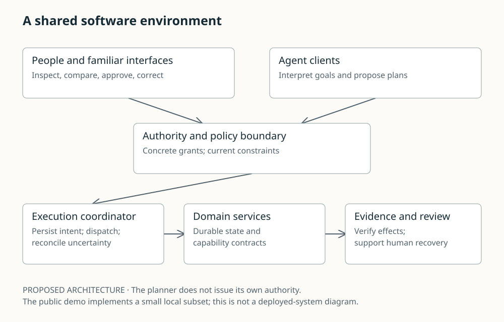

# A shared software environment

Proposed architecture: human and agent clients propose actions to a policy gate, then an execution coordinator invokes domain services and verifies evidence.

PROPOSED ARCHITECTURE · The planner does not issue its own authority. The public demo implements a small local subset; this is not a deployed-system diagram.

