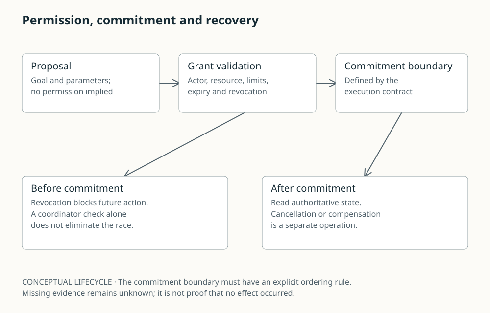

# Permission, commitment and recovery

A proposal passes through grant validation to a declared commitment boundary. Revocation before commitment blocks future action; afterward provider cancellation or compensation may be needed.

CONCEPTUAL LIFECYCLE · The commitment boundary must have an explicit ordering rule. Missing evidence remains unknown; it is not proof that no effect occurred.

