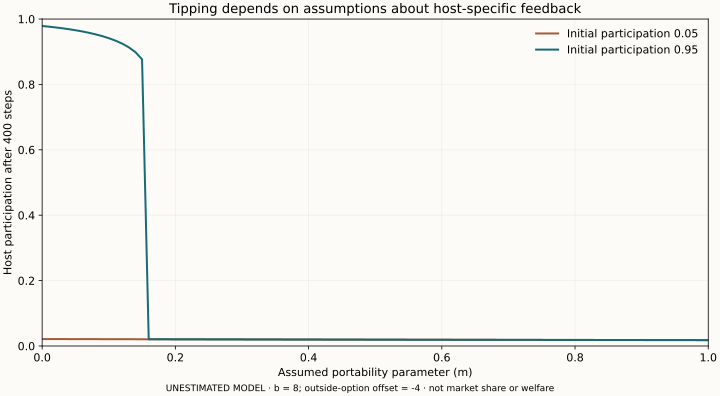

# Marketplace sensitivity

Unestimated participation model; portability changes only host-specific feedback. This does not measure welfare or market shares.

Rebuild with `python3 research/figures/marketplace.py` after installing `matplotlib==3.9.2`. The underlying model runs with Python alone.
