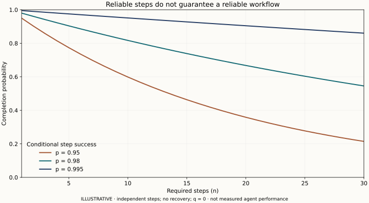

# Reliability sensitivity

Independent-step completion curves; changing p or the independence assumption changes the result.

Rebuild with `python3 research/figures/reliability.py` after installing `matplotlib==3.9.2`. The underlying model runs with Python alone.
