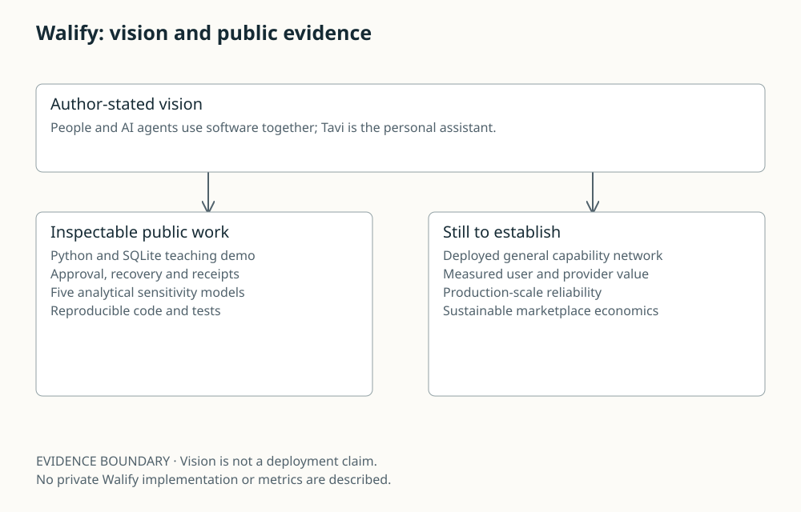

# Walify: vision and public evidence

Author-stated vision: people and agents use software together with Tavi as personal assistant. Public evidence is a local execution demo and analytical models. Deployment, adoption and market power are unmeasured.

EVIDENCE BOUNDARY · Vision is not a deployment claim. No private Walify implementation or metrics are described.

