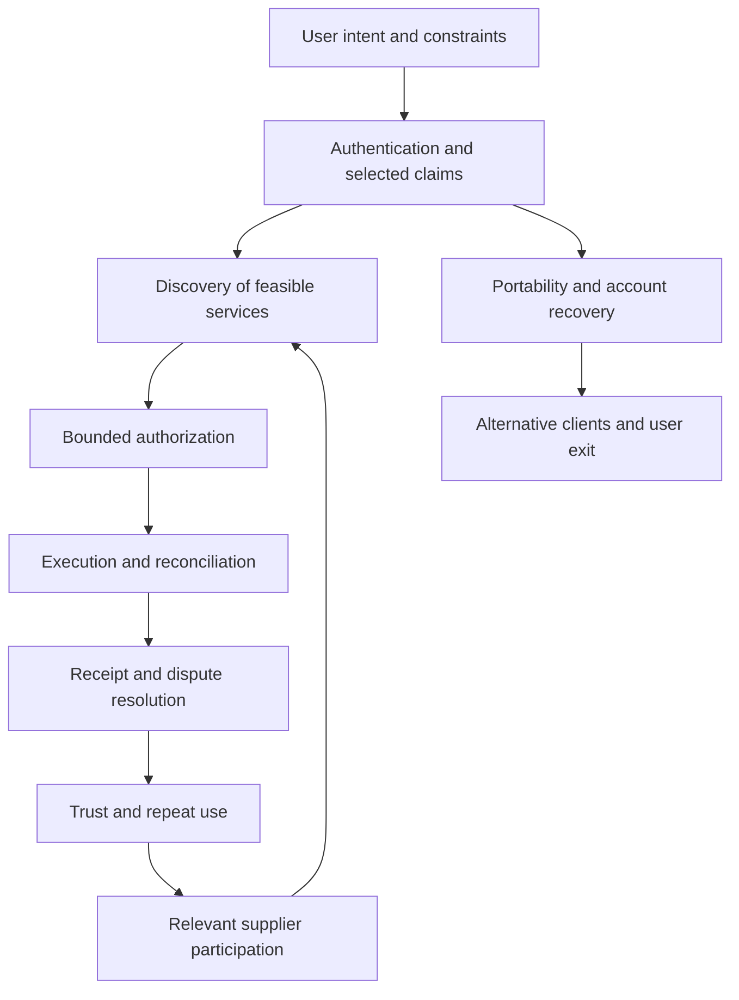

# Platform Power and the Shared Identity Layer

**Companion to The Internet of Delegated Action · 4 November 2026**

Harry Henry Hanrui Wang · AI-assisted analytical working paper

## Thesis

The next important software platform may coordinate intent across services: identify the user, discover a feasible offer, obtain bounded authority, execute reliably and preserve evidence. App stores and embedded-service ecosystems illustrate different ways of combining these functions. Their scale motivates the question; it does not prove that an agent marketplace will become a monopoly.

This companion adds 18 analytical notes and an executable sensitivity model to the [main paper](../../paper/PAPER.md). It focuses on mechanisms and proposed tests, rather than a ranking of the world's most powerful companies. Company announcements establish documented product features or reported quantities; standards establish protocol semantics. Neither substitutes for comparative field evidence.

## The mechanism



The feedback arrows are hypotheses. A larger catalog helps only when it increases relevant, reliable supply. Identity continuity helps only when permission boundaries and recovery remain sound. Exit and interoperability can constrain extraction while strengthening willingness to join.

## Compare mechanisms, not slogans

| Dimension | App-store model | Embedded-service model | Proposed intent-native model |
|---|---|---|---|
| Entry | Discover and install an app | Reach a service within an existing environment | Describe an outcome or invoke a capability |
| Trust surface | Distribution governance and app behavior | Host governance and service behavior | Provider contract, execution policy and receipts |
| Small-service cost | Separate distribution and maintenance obligations | Potentially shared runtime and entry points | Potentially reusable identity and action infrastructure |
| Bottleneck | Access, discovery and platform rules | Context, service reach and ecosystem boundaries | Routing, authorization and verified fulfillment |
| Failure to examine | Rejection, discovery cost, update regressions | Host dependency, inconsistent service backends | Wrong delegation, ambiguous effects, agent routing bias |
| Counterweight | Alternative distribution where available | Multihoming and external channels | Portable records, independent clients and explicit user choice |

These are analytical archetypes, not exhaustive descriptions. Real products overlap. No row claims that all embedded services are agent-callable or that a shared identity permits unrestricted access.

## Reading sequence

1. [Platform power is control over a sequence](01-platform-power.md)
2. [The App Store as a bundle of institutions](02-app-store-bundle.md)
3. [Take rate is not the same as economic power](03-take-rate.md)
4. [Weixin's advantage: services embedded in context](04-weixin-context.md)
5. [Network effects need a causal mechanism](05-network-effects.md)
6. [Local density beats global catalog size](06-local-density.md)
7. [Small software and the fixed-cost problem](07-small-software.md)
8. [Restaurant software as a transaction-state example](08-restaurant-workflow.md)
9. [From app screens to callable service contracts](09-agent-contracts.md)
10. [One identity: continuity without universal exposure](10-shared-identity.md)
11. [Identity and authority are separate resources](11-authentication-authority.md)
12. [Recovery defines the real strength of an identity system](12-identity-recovery.md)
13. [Portability is more than an identifier](13-portable-identity.md)
14. [Reputation is evidence with a domain](14-reputation.md)
15. [The agent as a new distribution gatekeeper](15-ranking-power.md)
16. [When concentration compounds—and when it fails](16-monopoly-conditions.md)
17. [Open participation can strengthen the platform](17-open-marketplace.md)
18. [A measurable thesis for the next software era](18-research-agenda.md)
19. [Synthetic economics and reproducible tests](19-synthetic-economics.md)

## What would make the opportunity defensible?

A useful coordination layer must create incremental completed tasks, reduce total cost and remain dependable when a provider or model fails. Its advantage becomes stronger if relevant supply attracts repeat demand and repeat demand justifies better supply. None of this follows from simply launching first.

The companion treats restaurant reservations as a generic small-service example. It does not describe Walify as a restaurant or loyalty product. The company connection remains the author's public thesis of a shared software environment for people and agents; no private code, infrastructure or operating metrics are included.

## Source and evidence discipline

The notes link primary materials from Apple, Tencent, the European Commission, the OpenID Foundation, IETF and W3C. Access date: 4 November 2026. Apple's ecosystem commerce estimate is not Apple revenue. The April 2025 DMA finding is a dated enforcement event, not a conclusion about every platform or later legal developments. Protocol support is not proof of adoption or correct implementation.

Sources supporting this companion are cited directly in each note; they are separate from the original paper's fixed 30-entry source register. Proposed experiments have not been run. The economic model uses synthetic inputs and does not estimate actual company outcomes.

## Reproduce the model and repository checks

```sh
python3 -m unittest discover -s demo -v
python3 -m unittest discover -s research/experiments -v
python3 -m unittest discover -s scripts -p 'test_*.py' -v
python3 scripts/validate_research.py
python3 scripts/run_models.py
python3 demo/scenarios.py
```

The added model contributes nine invariant tests, bringing the repository total to 59. Existing CI discovers them on Python 3.10 and 3.13. The link validator traverses this companion as part of the research directory; the original manuscript and HTML remain their own 25-chapter edition.
